# CSE 598 — LLM Serving Systems: Assignment Report

**Name:** Ananth Sundararajan Sekar
**Date:** October 30, 2026

---

## Part 0. Environment and Methodology

### 0.1 Hardware and software environment

All experiments were run interactively on a single GPU node of the ASU Sol cluster. The raw output is saved in `results/env.txt`.

| Component | Version / Value |
|---|---|
| GPU | NVIDIA A100-SXM4-80GB (80 GiB HBM2e, 81,920 MiB reported by `nvidia-smi`) |
| GPU power cap | 500 W |
| MIG | Disabled (full GPU available) |
| NVIDIA driver (kernel-mode) | 615.71.09 |
| Max CUDA supported by driver | 13.4 |
| CUDA version PyTorch was built with | 13.0 |
| cuDNN | 9.20.0 (reported as `92000`) |
| Python | 3.11.18 |
| PyTorch | 2.13.0+cu130 |
| Hugging Face Transformers | 5.19.0 |
| vLLM | 0.32.0 |

`nvidia-smi` reports the highest CUDA version the installed *driver* can run (13.4). `torch.version.cuda` reports the CUDA toolkit PyTorch was *compiled* against (13.0). A driver that supports a newer CUDA version can run binaries built for an older one, so this pairing is compatible.

At the time the environment was recorded, `nvidia-smi` showed 0 MiB in use and no running processes, so no other jobs were sharing the GPU.

Interactive sessions on Sol were allocated to different compute nodes (Part 1 on `sg029`, Part 2 on `sg046`). Every node used had the same GPU model (A100-SXM4-80GB), driver and software stack, and each comparison within a part was run in a single session on a single GPU.

### 0.2 Model and numerical precision

| Setting | Value |
|---|---|
| Model | `gpt2` (124M parameters, decoder-only causal LM) |
| Architecture | 12 layers, 12 attention heads, hidden size 768, head dim 64 |
| KV heads | 12 (multi-head attention; no grouped-query attention) |
| Maximum context | 1024 positions (`n_positions`) |
| Precision | FP16 for all GPU runs (Hugging Face and vLLM) |
| Decoding | Greedy (argmax / `temperature=0`) |

**Context-length constraint.** GPT-2 has learned absolute position embeddings for only 1024 positions, so every run must satisfy *prompt length + output length ≤ 1024*. The experiment parameters were chosen to respect this:

- Part 1 uses prompt lengths {128, 256, 512, 768} and output lengths {32, 64, 128, 256}, so the largest case is 768 + 256 = 1024.
- The Part 4 workload uses prompt lengths {32, 64, 128, 256, 512} and output lengths {16, 32, 64, 128, 256}. Static batching pads each batch to its longest prompt and runs to its longest output. Capping prompts at 512 keeps every batch, and every vLLM request, within the 1024-token `max_model_len`.

### 0.3 Measurement methodology

- **GPU synchronization.** Every timed region is wrapped by `utils.time_cuda_safe`, which calls `torch.cuda.synchronize()` immediately before reading the start time and immediately after the work finishes (see Question 0.1).
- **Warm-up.** Every script runs a short warm-up (prompt 32, output 4) before any measurement. The first CUDA calls pay one-time costs: creating the CUDA context, loading kernels, cuBLAS/cuDNN heuristic and algorithm selection, and growing the caching allocator. Excluding the warm-up keeps those costs out of the reported numbers.
- **Model loading excluded.** The model and tokenizer are loaded and moved to the GPU in `main()` before any timer starts. Download and load time is therefore never included in latency.
- **Fixed model, precision and hardware.** Every comparison uses gpt2 in FP16 on the same A100-SXM4-80GB.
- **Repetitions.** Each configuration is run 3 times, after a single warm-up at the start of the script. Tables report the mean ± standard deviation across the 3 runs. The raw per-run rows (with a `rep` column) are kept in `results/part1_prefill_decode.csv`, and the aggregates are in `*_mean.csv` and `*_std.csv`.
- **First run at a new input shape.** In Part 1, the first repetition (rep 0) at a new prompt length was often slower than reps 1–2. At prompt 512 / output 32 it took 20.9 ms vs. 9.7 and 9.3 ms. The warm-up only exercised a 32-token prompt, so the first call at each new sequence length still pays one-time costs such as choosing a GEMM/attention kernel for that shape. Averaging three runs reduces the effect, and the standard-deviation columns make it visible.
- **Synthetic inputs.** Prompts are random token IDs (`utils.synthetic_tokens`) with a fixed seed (`seed_everything(42)`). Content does not affect compute cost for a fixed sequence length, and fixed seeds make runs reproducible.
- **Memory metric.** Peak memory is `torch.cuda.max_memory_allocated()`, reset before each measured case. It counts tensors allocated by PyTorch, including the model weights. It is lower than the usage `nvidia-smi` shows, because `nvidia-smi` also counts the CUDA context and memory held in PyTorch's caching allocator but not currently allocated.

### Question 0.1 — Why is naive `time.perf_counter()` timing incorrect on a GPU?

```python
start = time.perf_counter()
output = model(input_ids)
end = time.perf_counter()
```

CUDA execution is **asynchronous** with respect to the host. When Python calls `model(input_ids)`, PyTorch *enqueues* a sequence of kernels on a CUDA stream and returns control to the CPU, usually before the GPU has finished, or even started, running them. The interval `end - start` therefore measures mostly CPU-side work: Python overhead, operator dispatch and kernel launch. It does not measure the time the GPU spends computing, so it usually **underestimates** latency.

There is also a second error in the opposite direction. Work enqueued *before* `start` may still be running on the GPU. If a later operation forces a sync inside the timed region, for example copying a result to the CPU, that leftover work is wrongly counted in this measurement.

`torch.cuda.synchronize()` blocks the host until every kernel queued on the device has completed. Correct timing calls it twice:

1. **before `start`**, so the GPU is idle and no earlier work leaks into the measurement;
2. **after the model call, before `end`**, so `end` is taken only after the GPU has actually finished.

This is the pattern in `utils.time_cuda_safe`. An alternative is `torch.cuda.Event(enable_timing=True)`, which records timestamps on the GPU stream itself.

**Empirical check.** A single FP16 8192 × 8192 matrix multiply was timed on the A100, after three warm-up multiplies:

| Timing method | Measured time |
|---|---|
| `perf_counter()` only (no synchronize) | 0.084 ms |
| `synchronize()` before start and before end | 4.528 ms |

Without synchronization, the measured time is about 54× too small. It captures only the kernel launch. The synchronized time agrees with the expected cost of the matmul: 2 · 8192³ ≈ 1.10 × 10¹² FLOPs in 4.528 ms ≈ 243 TFLOP/s, about 78% of the A100's 312 TFLOP/s FP16 Tensor Core peak. So the synchronized number reflects the GPU's actual compute time, and the unsynchronized one does not.

---

## Part 1. Prefill and Decode

### What is asked

- **Task 1.1** — For at least 3 prompt lengths × 3 output lengths, measure prefill latency, decode latency, end-to-end latency, average decode time per output token (TPOT), and peak GPU memory.
- **Task 1.2** — Plots: prompt length vs. prefill latency; output length vs. decode latency; output length vs. TPOT.
- **Task 1.3** — Answer the six analysis questions below.

### Experimental parameters

| Parameter | Value |
|---|---|
| Prompt lengths | 128, 256, 512, 768 |
| Output lengths | 32, 64, 128, 256 |
| Batch size | 1 |
| Decoding | Greedy, manual loop with `past_key_values` (no `generate()`, no early EOS stop) |
| Precision | FP16 |
| Warm-up | 1 run (prompt 32, output 4) before measurement |
| Repetitions | 3 per configuration (48 runs in total) |
| Script | `python part1_prefill_decode.py --out results/part1_prefill_decode.csv` |
| Output | `results/part1_prefill_decode.csv` (raw), `_mean.csv`, `_std.csv` |

**Metric definitions.**
- **Prefill** is one forward pass over the full prompt, which also produces the first output token.
- **Decode** is the loop of `output_length` single-token forward passes that reuse the KV cache.
- **End-to-end** = prefill + decode.
- **TPOT** = decode time / `output_length`, i.e. the mean time per decode step.
- **Peak memory** is `torch.cuda.max_memory_allocated()` and includes the FP16 weights (124.4M params × 2 B ≈ 0.232 GiB).

### Task 1.1 — Results (mean ± std over 3 runs)

| Prompt | Output | Prefill (ms) | Decode (ms) | End-to-end (ms) | TPOT (ms/token) | Peak memory (GiB) |
|---:|---:|---:|---:|---:|---:|---:|
| 128 | 32 | 8.01 ± 1.01 | 177.1 ± 0.7 | 185.1 ± 0.8 | 5.534 ± 0.023 | 0.2635 |
| 128 | 64 | 7.45 ± 0.03 | 357.5 ± 1.5 | 365.0 ± 1.5 | 5.586 ± 0.023 | 0.2647 |
| 128 | 128 | 7.57 ± 0.12 | 717.4 ± 8.4 | 725.0 ± 8.5 | 5.605 ± 0.066 | 0.2670 |
| 128 | 256 | 7.49 ± 0.02 | 1445.2 ± 10.4 | 1452.7 ± 10.4 | 5.645 ± 0.041 | 0.2715 |
| 256 | 32 | 8.06 ± 0.71 | 183.7 ± 3.0 | 191.8 ± 3.7 | 5.741 ± 0.094 | 0.2801 |
| 256 | 64 | 8.85 ± 2.18 | 363.8 ± 4.8 | 372.6 ± 3.0 | 5.684 ± 0.074 | 0.2812 |
| 256 | 128 | 9.42 ± 3.21 | 724.3 ± 3.9 | 733.7 ± 0.9 | 5.659 ± 0.030 | 0.2835 |
| 256 | 256 | 7.67 ± 0.06 | 1454.4 ± 10.3 | 1462.1 ± 10.2 | 5.681 ± 0.040 | 0.2881 |
| 512 | 32 | 13.28 ± 6.61 | 180.0 ± 0.4 | 193.3 ± 6.3 | 5.625 ± 0.012 | 0.3141 |
| 512 | 64 | 9.40 ± 0.15 | 361.0 ± 0.5 | 370.4 ± 0.4 | 5.640 ± 0.007 | 0.3152 |
| 512 | 128 | 9.34 ± 0.05 | 720.1 ± 4.0 | 729.5 ± 4.0 | 5.626 ± 0.032 | 0.3175 |
| 512 | 256 | 9.45 ± 0.10 | 1451.0 ± 10.2 | 1460.5 ± 10.1 | 5.668 ± 0.040 | 0.3353 |
| 768 | 32 | 8.35 ± 1.23 | 179.3 ± 0.3 | 187.7 ± 1.1 | 5.604 ± 0.009 | 0.3486 |
| 768 | 64 | 7.56 ± 0.04 | 357.3 ± 3.1 | 364.8 ± 3.1 | 5.583 ± 0.048 | 0.3497 |
| 768 | 128 | 8.07 ± 0.63 | 713.8 ± 5.9 | 721.9 ± 6.2 | 5.577 ± 0.046 | 0.3511 |
| 768 | 256 | 7.67 ± 0.12 | 1425.9 ± 11.9 | 1433.6 ± 11.8 | 5.570 ± 0.047 | 0.3555 |

The 13.28 ± 6.61 ms prefill at prompt 512 / output 32 is caused by a single slow first run (20.9 ms) at a new prompt length (see Part 0). The other two runs took 9.7 and 9.3 ms.

**Summary statistics.**
- **Prefill:** with the slow first runs excluded (reps 1–2 only), prefill is 7.5, 8.1, 9.4 and 7.9 ms for prompts of 128, 256, 512 and 768 tokens. That is nearly flat across a 6× change in prompt length.
- **Decode:** a linear fit of decode latency against output length gives a slope of **5.64 ms/token**, an intercept of −1.5 ms, and **R² = 0.9998**.
- **TPOT:** across all 16 configurations it ranges from 5.53 to 5.74 ms (mean 5.63 ms, a spread of about ±2%).

### Task 1.2 — Plots

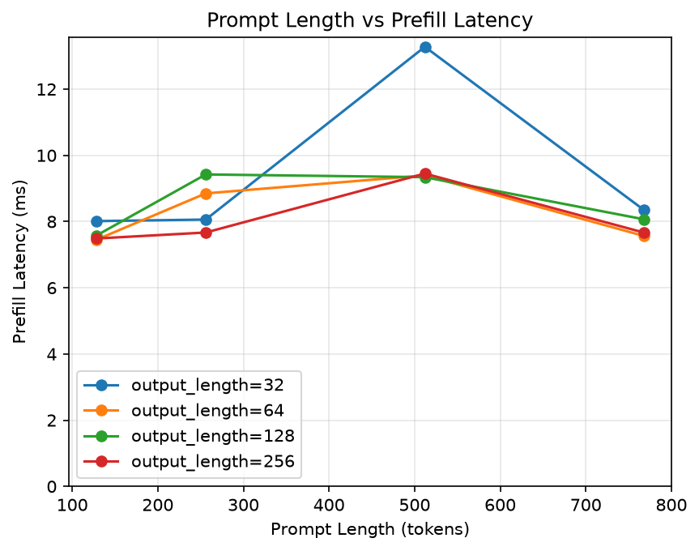

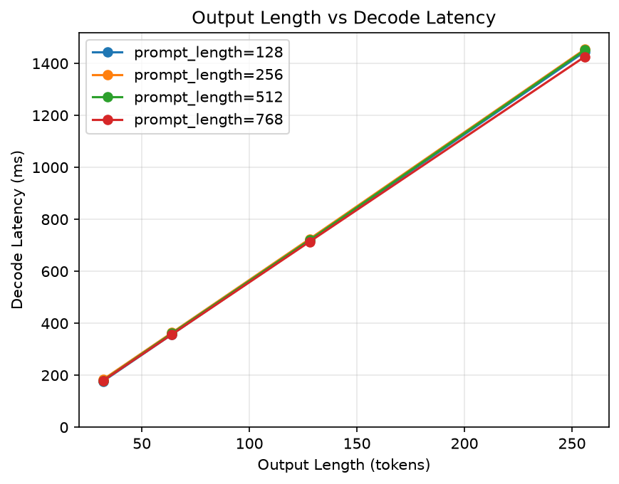

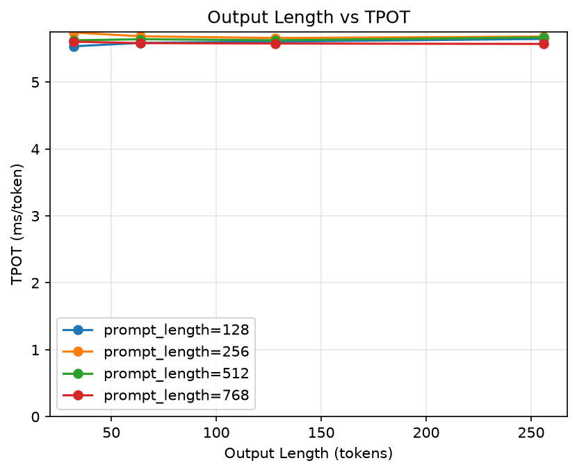

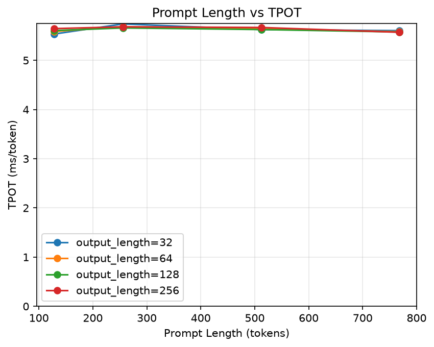

PDF versions of each figure are in `plots/`.

### Analysis

Reference numbers used below:
- A100-SXM4-80GB FP16 Tensor Core peak: about 312 TFLOP/s. Measured earlier: 243 TFLOP/s on an 8192² matmul.
- HBM bandwidth: about 2.0 TB/s.
- gpt2 FP16 weights: 124.4M params × 2 B ≈ 249 MB.
- KV cache per token: 2 × 12 layers × 12 heads × 64 × 2 B = 36,864 B ≈ 36 KiB.

**1. Why does prompt length affect prefill?**

Prefill runs every prompt token through every layer in one forward pass. The linear layers cost about 2 × (parameters) FLOPs per token, so their work grows linearly with prompt length *n*. Self-attention compares every token with every earlier token, so its work and its score matrix grow as *n*².

In principle, then, prefill latency should rise with *n*. In our measurements it barely does: the clean runs went from 7.5 ms at 128 tokens to 7.9 ms at 768 tokens. The work is simply too small to fill the GPU. A 768-token prefill is about 2 × 124.4M × 768 ≈ 1.9 × 10¹¹ FLOPs, which takes about **0.8 ms** at our measured 243 TFLOP/s. The measured time is about 7.6 ms. Roughly 90% of prefill time is therefore a fixed per-forward-pass cost: Python and Hugging Face module dispatch, plus launching a few hundred small kernels across 12 layers. That cost does not depend on *n*.

The slightly higher time at 512 tokens (about 9.4 ms) than at 768 (about 7.9 ms) is also consistent with an overhead-dominated regime. The library selects different GEMM/attention kernels for different sequence shapes, and at this scale those per-shape differences outweigh the extra FLOPs.

Prompt length *does* clearly show up in memory, through the tensors prefill creates. Moving from 128 to 768 tokens raises peak memory by 87.2 MiB (269.8 → 357.0 MiB at output 32). That matches the prediction for 640 extra tokens:
- full-prompt logits: 640 × 50,257 vocab × 2 B ≈ 61.4 MiB;
- KV cache: 640 × 36 KiB ≈ 22.5 MiB;
- total predicted: 83.9 MiB.

The same per-token estimate (≈ 0.131 MiB per prompt token) also predicts the 128 → 256 step (16.8 MiB predicted, 17.0 MiB measured).

**2. Why does output length affect decode?**

Autoregressive decoding is sequential. Token *t* + 1 depends on token *t*, so *m* output tokens require *m* forward passes that cannot run in parallel. Decode latency is therefore proportional to *m*. Our data fits this almost perfectly: decode latency = 5.64 ms × *m* − 1.5 ms, with R² = 0.9998. The four prompt-length lines in the decode plot lie on top of each other.

**3. Why can prefill expose more GPU parallelism than decode?**

In prefill, the activations entering each layer form an *n* × 768 matrix, so every weight matrix multiplies against *n* rows at once. The GPU can spread those rows across thousands of cores and Tensor Cores, and the weights are loaded from memory once and reused *n* times.

In decode, the input is a single 1 × 768 row. Each layer becomes a matrix-vector product with very little independent work per kernel. Most of the GPU sits idle, and each weight is used for only one token before the next step reloads it.

Our numbers show this directly. Processing **768 tokens in one prefill takes about 7.6 ms, while generating one token takes 5.6 ms**. Per token, prefill costs about 0.010 ms versus 5.6 ms for decode, roughly **570× cheaper**.

**4. Which phase appears more compute intensive?**

**Prefill.** Its arithmetic intensity (FLOPs per byte loaded) is high. Each FP16 weight (2 B) is used in about 2*n* FLOPs, so intensity is about *n* FLOP/byte. That is 128–768 FLOP/byte for our prompts, at or above the A100's balance point of about 312 TFLOP/s ÷ 2.0 TB/s ≈ 150 FLOP/byte. Prefill FLOPs also grow with *n* (and *n*² for attention), while decode does almost no arithmetic per step: about 2.5 × 10⁸ FLOPs, roughly 1 µs of work at the A100's measured throughput.

In our gpt2 runs, prefill latency is not yet *dominated* by compute, because only about 0.8 ms of its 7.6 ms is arithmetic. But it is the phase whose cost would scale with compute for a larger model or a longer prompt.

**5. Which phase appears more memory-bandwidth sensitive?**

**Decode.** Every decode step must read all the weights (about 249 MB) plus the whole KV cache, only to produce one token. Its arithmetic intensity is about 1 FLOP/byte, far below the A100's balance point. That puts decode firmly in the memory-bound regime: the speed limit is how fast bytes come from HBM, not how fast the GPU computes.

For gpt2 specifically, even this bound is small. 249 MB at 2.0 TB/s ≈ **0.12 ms**, yet our measured TPOT is 5.6 ms, about 45× higher. The remaining time is fixed per-step overhead (Python, Hugging Face module dispatch, and launching hundreds of small kernels per step). Our measurement is therefore *overhead-bound*, which is a worse version of the same problem: the GPU does very little useful work per step.

Decode is the phase sensitive to anything that adds bytes per step (larger weights, longer KV cache). Prefill is limited by arithmetic and does not have this problem. Batching (Part 3) is the standard fix: it reuses each weight read across many sequences.

**6. Does TPOT remain constant as the context grows? If not, why?**

**In our measurements, yes, to within noise.** TPOT stays between 5.53 and 5.74 ms (±2%) across every configuration. There is no consistent trend with prompt length: averaged over output lengths it is 5.59, 5.69, 5.64 and 5.58 ms for prompts of 128, 256, 512 and 768. Nor is there a trend with output length: 5.63, 5.62, 5.62 and 5.64 ms for outputs of 32, 64, 128 and 256.

**In principle, TPOT should grow with context.** At decode step *t*, attention has to read the K and V of all *n* + *t* earlier tokens, so the bytes read and the attention FLOPs per step grow linearly with context length.

The effect is invisible here because it is tiny compared with the fixed overhead. At the largest context we ran (1024 tokens), the KV cache is 1024 × 36 KiB ≈ 36 MiB. Reading it takes about 0.018 ms at 2.0 TB/s, about **0.3% of a 5.6 ms step**, which is below our run-to-run variation (std ≈ 0.01–0.09 ms).

For a larger model, long contexts, or large batches, the KV read per step becomes comparable to or larger than the weight read, and TPOT rises roughly linearly with context. That effect is what makes long-context serving expensive (see Part 2).

---

## Part 2. KV Cache

### What is asked

- **Task 2.1** — Complete `generate_without_cache()`: pass the whole sequence at every step, use `use_cache=False`, append each generated token.
- **Task 2.2** — Compare cache on vs. off for several output lengths: total latency, ms per output token, peak GPU memory.
- **Task 2.3** — Derive the KV-cache size formula, explain the factor of 2, and check it with `part2_kv_size.py` for at least one configuration.
- **Task 2.4** — Answer the four analysis questions below.

### Implementation (Task 2.1)

`generate_without_cache()` repeats three steps for each output token:

1. Run the model over the **entire** current sequence (prompt plus every token generated so far) with `use_cache=False`, so no keys or values are reused from earlier steps.
2. Take the logits at the last position and choose the next token greedily with `argmax(..., keepdim=True)`, which keeps the shape `[batch, 1]`.
3. Append that token to the sequence with `torch.cat(..., dim=1)`.

**Agreement check.**
- At batch size 1, cached and uncached generation produced **identical tokens** at every output length (match rate 1.0).
- At batch size 32, **exactly 2 generated tokens differ** at every output length, out of 32 × *m* (up to 28,672), the first at generated position 2 (match rate ≥ 0.998).
  - The cause is FP16 rounding, not a logic error. The cached path multiplies one new token against stored K/V, while the uncached path recomputes the full sequence. The two use different kernels and summation orders, so a near-tie between two candidate tokens can flip.
  - With greedy decoding on random prompts, gpt2 falls quickly into a repetitive pattern, so the affected row rejoins the same token sequence after the flip.

**Two fixes were needed to run batched experiments.**
1. **`agreement_check()` crash.** As provided, it looked for the first mismatch only in row 0, so it raised `IndexError` when row 0 matched but another row diverged. It now reports the earliest mismatching position across all rows in that case.
2. **Allocator fragmentation.** At batch 32 without the cache, every step allocates slightly larger tensors than the step before. PyTorch's caching allocator kept reserving new blocks until all 80 GB was reserved for only a few GB of live data. It then hit OOM, flushed its cache and retried, which added time to the measurements. Both batch sizes were therefore run with `PYTORCH_CUDA_ALLOC_CONF=expandable_segments:True`.

### Experimental parameters

| Parameter | Value |
|---|---|
| Prompt length | 128 (random tokens, fixed seed) |
| Output lengths | 32, 128, 256, 512, 896 (128 + 896 = 1024, gpt2's maximum) |
| Batch sizes | 1 and 32 (separate runs) |
| Repetitions | 3 per configuration, after one warm-up of each method |
| Precision | FP16 |
| Allocator | `PYTORCH_CUDA_ALLOC_CONF=expandable_segments:True` |
| Command | `python part2_kv_cache.py --batch-size {1,32} --out results/part2_kv_cache_b{1,32}.csv` |
| Output | `results/part2_kv_cache_b{1,32}.csv` (raw), `_mean.csv`, `_std.csv` |

**Metric definitions.**
- **Latency** is the whole generation call: prefill plus all decode steps.
- **ms per step** is latency ÷ `output_length`. At batch 32 each step produces 32 tokens, one per sequence.
- **Peak memory** is `torch.cuda.max_memory_allocated()` and includes the 0.232 GiB of FP16 weights.

### Results (Task 2.2)

**Batch size 1** (mean ± std over 3 runs)

| Output | Cache | Latency (s) | ms per step | Peak memory (GiB) | Match rate |
|---:|:---:|---:|---:|---:|---:|
| 32 | on | 0.178 ± 0.001 | 5.56 ± 0.03 | 0.256 | 1.00000 |
| 32 | off | 0.177 ± 0.002 | 5.53 ± 0.05 | 0.270 | 1.00000 |
| 128 | on | 0.709 ± 0.002 | 5.54 ± 0.02 | 0.256 | 1.00000 |
| 128 | off | 0.703 ± 0.001 | 5.49 ± 0.01 | 0.288 | 1.00000 |
| 256 | on | 1.443 ± 0.006 | 5.64 ± 0.02 | 0.256 | 1.00000 |
| 256 | off | 1.422 ± 0.014 | 5.56 ± 0.06 | 0.312 | 1.00000 |
| 512 | on | 2.854 ± 0.004 | 5.57 ± 0.01 | 0.263 | 1.00000 |
| 512 | off | 2.917 ± 0.015 | 5.70 ± 0.03 | 0.360 | 1.00000 |
| 896 | on | 5.024 ± 0.016 | 5.61 ± 0.02 | 0.277 | 1.00000 |
| 896 | off | 5.308 ± 0.021 | 5.92 ± 0.02 | 0.433 | 1.00000 |

**Batch size 32** (mean ± std over 3 runs)

| Output | Cache | Latency (s) | ms per step | Peak memory (GiB) | Match rate |
|---:|:---:|---:|---:|---:|---:|
| 32 | on | 0.188 ± 0.000 | 5.89 ± 0.00 | 0.771 | 0.99805 |
| 32 | off | 0.472 ± 0.006 | 14.76 ± 0.18 | 1.197 | 0.99805 |
| 128 | on | 0.745 ± 0.004 | 5.82 ± 0.03 | 0.771 | 0.99951 |
| 128 | off | 2.443 ± 0.014 | 19.09 ± 0.11 | 1.776 | 0.99951 |
| 256 | on | 1.488 ± 0.007 | 5.81 ± 0.03 | 0.771 | 0.99976 |
| 256 | off | 6.434 ± 0.017 | 25.13 ± 0.07 | 2.549 | 0.99976 |
| 512 | on | 2.963 ± 0.010 | 5.79 ± 0.02 | 0.975 | 0.99988 |
| 512 | off | 19.045 ± 0.004 | 37.20 ± 0.01 | 4.095 | 0.99988 |
| 896 | on | 5.400 ± 0.006 | 6.03 ± 0.01 | 1.415 | 0.99993 |
| 896 | off | 49.702 ± 0.017 | 55.47 ± 0.02 | 6.413 | 0.99993 |

**Slowdown from disabling the cache** (latency without cache ÷ latency with cache):

| Output length | 32 | 128 | 256 | 512 | 896 |
|---|---:|---:|---:|---:|---:|
| Batch 1 | 0.99× | 0.99× | 0.99× | 1.02× | 1.06× |
| Batch 32 | 2.5× | 3.3× | 4.3× | 6.4× | **9.2×** |

**Key observations.**
- **Batch 32 without the cache grows quadratically.** Total latency fits *a·m + b·m²* with **R² = 0.9999995**, while a straight line fits with R² = 0.962. Dividing latency by the number of token positions the model actually processes (32 × Σₜ (128 + *t*)) gives a nearly constant **3.0–3.2 µs per token** at every output length. The extra time is accounted for entirely by recomputation.
- **With the cache, cost per step is flat** at 5.8–6.0 ms (batch 32) and 5.5–5.6 ms (batch 1), regardless of length.
- **At batch 1 the two methods are indistinguishable** until 896 tokens (1.06×). As in Part 1, a single-sequence forward pass is dominated by a fixed ~5.5 ms of Python and kernel-launch overhead, which hides the recomputation.

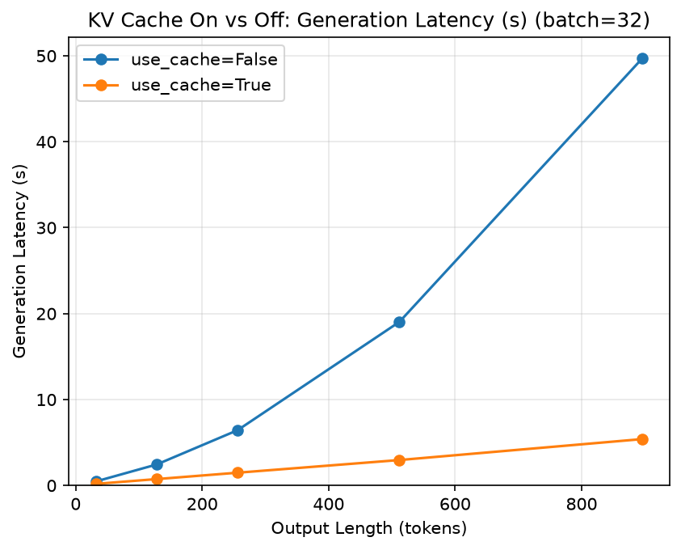

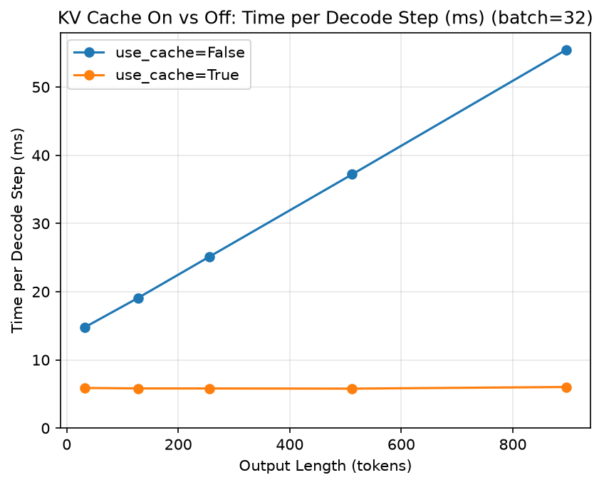

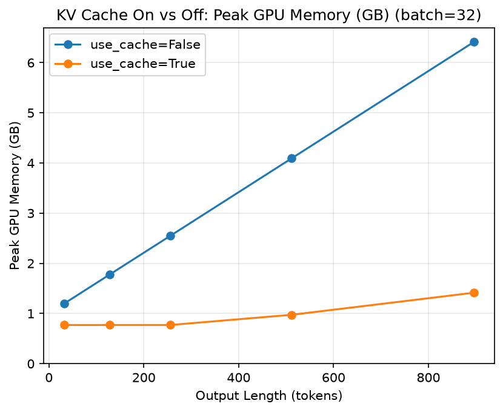

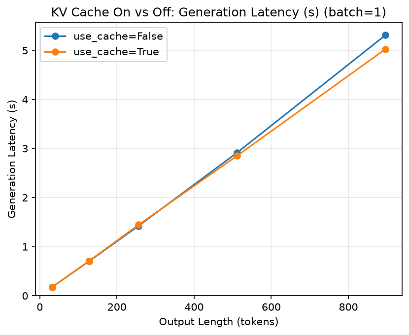

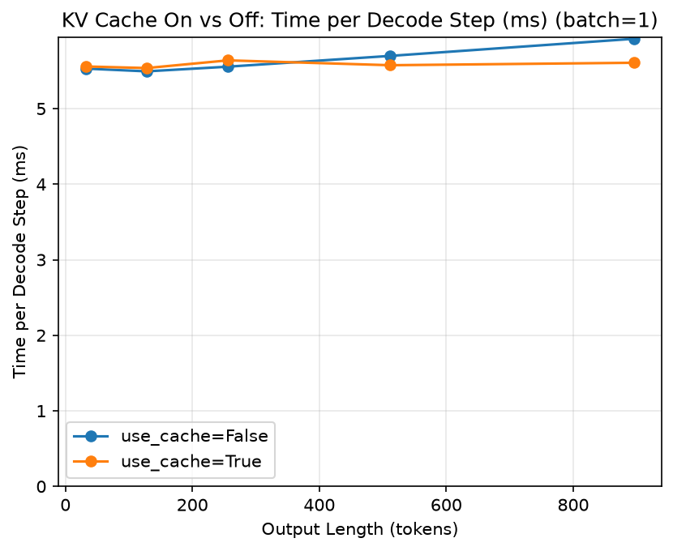

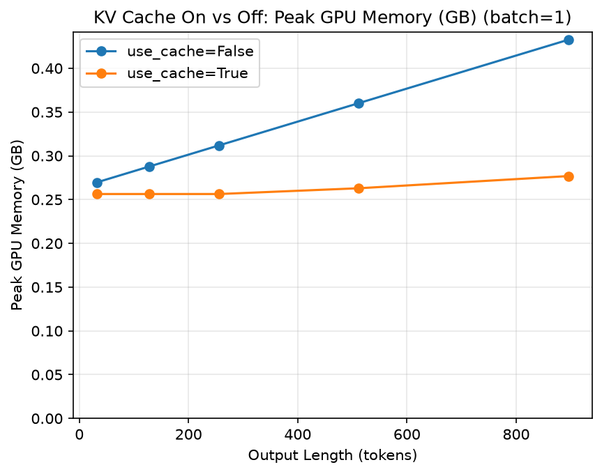

### KV-cache memory derivation (Task 2.3)

**Derivation.** In each attention layer, every token's hidden state is projected to a key vector and a value vector for each of the *H_kv* KV heads, each of dimension *D*. For *B* sequences of cached length *S*, one layer therefore stores:

- a key tensor of shape [*B*, *H_kv*, *S*, *D*], i.e. *B·H_kv·S·D* elements;
- a value tensor of the same shape, another *B·H_kv·S·D* elements.

Summing over *L* layers and multiplying by *b* bytes per element:

$$
\text{KV bytes} \;=\; 2 \cdot B \cdot L \cdot S \cdot H_{kv} \cdot D \cdot b
$$

**The factor of 2** is there because attention needs both keys and values of every earlier token, and they are separate tensors with identical shapes. Keys are compared with the current query to produce attention weights, and values are the vectors those weights average. Queries are *not* cached: each token's query is used only at the step that produced it.

With grouped-query attention, *H_kv* is smaller than the number of query heads, which shrinks the cache proportionally. gpt2 uses standard multi-head attention, so *H_kv* = 12.

**Per-token cost:**
- gpt2: 2 × 12 × 12 × 64 × 2 B = 36,864 B = **36 KiB per token per sequence**.
- Llama-8B-style configuration: 2 × 32 × 8 × 128 × 2 B = 131,072 B = **128 KiB per token**.

**Checks with `part2_kv_size.py`:**

| Configuration | Command | Result |
|---|---|---|
| gpt2, *B* = 1, *S* = 1024 | `python part2_kv_size.py --layers 12 --kv-heads 12 --head-dim 64 --seq-len 1024` | 37,748,736 B = **36.00 MiB** |
| gpt2, *B* = 32, *S* = 1024 | `... --batch-size 32` | 1,207,959,552 B = **1.125 GiB** |
| Llama-8B-style (*L* = 32, *H_kv* = 8, *D* = 128, *S* = 4096), *B* = 1 | `python part2_kv_size.py` (defaults) | 536,870,912 B = **512 MiB** |

**Agreement with measured memory.** At batch 32 with 896 output tokens, the cached sequence reaches 1024 tokens. The formula predicts 1.125 GiB of KV cache. Measured peak memory was 1.415 GiB, or 1.183 GiB after subtracting the 0.232 GiB of weights. That is within about 5% of the prediction; the small remainder is temporaries such as the copy made when each layer's cache grows by concatenation.

The cached memory curve is also explained by the formula. Up to 256 output tokens, peak memory stays at 0.771 GiB because the peak is set by **prefill**: the prompt's logits (32 × 128 × 50,257 × 2 B = 0.38 GiB) plus the weights and the 128-token cache (0.14 GiB). Those logits are freed after the first step. The cache grows by 32 × 36 KiB = 1.125 MiB per generated token, so it needs about 350 more tokens (roughly 480 in total) to exceed that earlier peak. After that point, memory rises in proportion to *S*.

### Analysis (Task 2.4)

**1. Why does caching reduce redundant computation?**

In a causal Transformer, the key and value of token *i* depend only on tokens 1…*i*. Once computed, they never change, no matter how many tokens follow.

Without a cache, every decode step recomputes K and V (and the full layer stack) for every earlier token. Generating *m* tokens after an *n*-token prompt therefore processes Σₜ (*n* + *t*) ≈ *nm* + *m*²/2 token positions instead of *n* + *m*. For *n* = 128 and *m* = 896, that is **515,648 positions per sequence versus 1,024**, about 500× more work. With a cache, each step processes only the newest token and reads the stored K/V of the rest.

Our measurements confirm this. At batch 32:
- no-cache latency grows quadratically (R² = 0.9999995) and costs a constant ~3 µs per processed token position;
- cached latency grows linearly at about 5.9 ms per step;
- disabling the cache is **9.2× slower at 896 tokens**, and the gap widens with length.

The measured slowdown is far below 500× for two reasons. Recomputation is done in large, efficient prefill-style passes, and every cached step still pays the fixed ~5.5 ms per-forward overhead. At batch 1 that overhead hides the redundant work almost completely (0.99–1.06×). The recomputation is still happening, but it is cheap relative to the per-step overhead until the batch and sequence are large.

**2. Why does cache memory grow with sequence length?**

The cache must keep K and V for *every* token the model may still attend to. Each new token adds one key and one value per layer per KV head, so cache size is linear in *S*: 2·*L*·*H_kv*·*D*·*b* bytes per token (36 KiB for gpt2) for each sequence.

We observed this directly. At batch 32, cached peak memory rose from 0.77 to 1.41 GiB as the sequence grew to 1024 tokens, within about 5% of the 1.125 GiB the formula predicts. Memory without the cache grew even faster (1.20 → 6.41 GiB), because each step re-creates logits for every position (3.06 GiB at 1023 tokens). Here the cache saves memory as well as time.

**3. Why does long-context serving reduce concurrency?**

GPU memory is fixed. After the weights (and activation workspace), the remainder is a budget for KV caches, and each active request needs 2·*L*·*H_kv*·*D*·*b*·*S* bytes. The maximum number of concurrent requests is therefore roughly:

> KV budget ÷ (bytes per token × context length)

so it falls in **inverse proportion to context length**.

For the Llama-8B-style configuration on our 80 GB A100:
- the weights take about 16 GB, leaving roughly 60 GB for KV;
- each 4096-token request needs 512 MiB, allowing about **110 concurrent requests**;
- at 32k tokens each request needs 4 GiB, allowing about **14**.

Even gpt2's tiny cache reaches 1.125 GiB for 32 sequences of 1024 tokens. Fewer concurrent requests means smaller decode batches, which (Part 3) means lower throughput.

**4. Why can a serving system become memory-limited even when compute is available?**

Decode does very little arithmetic per step. It is limited by overhead and memory bandwidth, not FLOPs (Part 1). Batching is how a serving system raises GPU utilization, and our data shows how cheap extra sequences are in compute terms: a cached decode step at **batch 32 took 5.89 ms versus 5.56 ms at batch 1, 32× the tokens for 6% more time**. In principle the server could keep adding requests to the batch.

Every additional request, however, brings its own KV cache, which grows as the request generates. The batch can only grow until the KV caches fill the memory budget. Past that point the system must queue or reject new requests, or evict existing ones, even though the Tensor Cores are mostly idle. Memory capacity, not compute, sets the limit.

This gets worse when memory is wasted:
- reserving each request's maximum possible context up front;
- fragmentation from caches of different, growing sizes.

We saw an extreme case of fragmentation in the no-cache batch-32 run. PyTorch's allocator had reserved all 80 GB while only a few GB were in use, and it hit OOM. Mechanisms such as paged KV-cache management (Part 4) exist to reduce exactly this waste.

---

## Part 3. Batching

### What is asked

- **Task 3.1** — For several batch sizes, measure TTFT (approximation), TPOT, end-to-end latency, requests/s, output tokens/s, and peak GPU memory.
- **Task 3.2** — Plots: batch size vs. tokens/s; batch size vs. latency; batch size vs. peak memory.
- **Task 3.3** — Answer the five analysis questions below.

### Experimental parameters

| Parameter | Value |
|---|---|
| Batch sizes | 1, 2, 4, 8, 16, 32, 64, 128, 256, 512 |
| Prompt length | 128 (random tokens; identical length for every request) |
| Output length | 128 |
| Repetitions | 3 per batch size, after one warm-up (batch 1, prompt 32, output 4) |
| Precision | FP16 |
| Allocator | `PYTORCH_CUDA_ALLOC_CONF=expandable_segments:True` |
| Command | `python part3_batching.py --out results/part3_batching.csv` |
| Output | `results/part3_batching.csv` (raw), `_mean.csv`, `_std.csv` |

The starter script stopped at batch 16. We extended it to 512 because, at 16, throughput was still rising in proportion to batch size, so the point of diminishing returns (Q3) would not have been visible. Batch 512 used 11.1 GiB, so the run never hit the script's out-of-memory guard.

### Metric definitions (TODO 2 in the starter code)

All *B* requests in a batch start together, have the same prompt and output lengths, and therefore finish together. Each formula relies on that.

| Metric | Formula | Meaning and caveats |
|---|---|---|
| `ttft_ms` | prefill time × 1000 | Time for one forward pass over all *B* × 128 prompt tokens, which produces every request's first token. It is only an **approximation** of TTFT. A real TTFT is measured from when a request *arrives* until its first token reaches the user, so it also includes time queued waiting for a batch, scheduling, tokenization and network delay. None of those exist here, because every request is ready at time 0. |
| `tpot_ms` | decode time × 1000 ÷ `output_length` | Average time per decode step. Each step produces one token for *every* request in the batch, so this is also the inter-token latency each individual user sees. |
| `latency_sec` | prefill + decode | End-to-end latency of every request, since they all start and finish together. |
| `requests_per_sec` | *B* ÷ `latency_sec` | Correct only because the whole batch finishes at once. With mixed output lengths, requests would finish at different times and the batch would be held until the longest one finished (Part 4). |
| `tokens_per_sec` | *B* × `output_length` ÷ `latency_sec` | Aggregate output throughput. Prompt tokens are not counted, but prefill time *is* in the denominator, as a user would experience. Prefill also produces one token per request before the `output_length` decode steps, so each request actually generates `output_length` + 1 tokens. The formula therefore undercounts by 1/129 (< 1%). |
| `peak_memory_gb` | `torch.cuda.max_memory_allocated()` | Includes the 0.232 GiB of weights. The prefill `outputs` (full prompt logits) stay referenced during decode in this script, so they are part of the peak. |

### Task 3.1 — Results (mean ± std over 3 runs)

| Batch | TTFT approx. (ms) | TPOT (ms) | Latency (s) | Requests/s | Output tokens/s | Peak memory (GiB) |
|---:|---:|---:|---:|---:|---:|---:|
| 1 | 7.7 ± 1.0 | 5.49 ± 0.03 | 0.711 ± 0.003 | 1.4 | 180 ± 1 | 0.261 |
| 2 | 7.6 ± 0.2 | 6.03 ± 0.72 | 0.779 ± 0.092 | 2.6 | 331 ± 37 | 0.282 |
| 4 | 8.8 ± 0.1 | 5.56 ± 0.00 | 0.721 ± 0.001 | 5.6 | 711 ± 1 | 0.325 |
| 8 | 11.6 ± 2.9 | 5.54 ± 0.01 | 0.721 ± 0.004 | 11.1 | 1,420 ± 8 | 0.410 |
| 16 | 15.6 ± 2.8 | 5.51 ± 0.03 | 0.721 ± 0.006 | 22.2 | 2,840 ± 25 | 0.580 |
| 32 | 15.3 ± 0.2 | 5.78 ± 0.03 | 0.755 ± 0.003 | 42.4 | 5,425 ± 25 | 0.919 |
| 64 | 28.5 ± 0.7 | 5.81 ± 0.03 | 0.772 ± 0.004 | 82.9 | 10,612 ± 55 | 1.599 |
| 128 | 56.4 ± 4.4 | 6.44 ± 0.02 | 0.881 ± 0.007 | 145.2 | 18,590 ± 139 | 2.958 |
| 256 | 104.1 ± 0.1 | 11.41 ± 0.00 | 1.565 ± 0.001 | 163.6 | 20,941 ± 8 | 5.677 |
| 512 | 205.5 ± 0.0 | 21.57 ± 0.01 | 2.966 ± 0.001 | 172.6 | 22,092 ± 6 | 11.114 |

The larger standard deviations at batch 2 (TPOT) and at batches 8–16 (TTFT) come from the first repetition at each new batch shape, as in Part 1. At batch 2, rep 0 had a TPOT of 6.86 ms versus 5.63 and 5.59 ms for reps 1–2. Likewise, batch 16's TTFT is 14.1 ms without its first run, so the apparent dip at batch 32 is not a real effect.

**Scaling summary.**

| Batch | 1 | 2 | 4 | 8 | 16 | 32 | 64 | 128 | 256 | 512 |
|---|---:|---:|---:|---:|---:|---:|---:|---:|---:|---:|
| Throughput gain over the previous batch size | — | 1.84× | 2.14× | 2.00× | 2.00× | 1.91× | 1.96× | 1.75× | **1.13×** | **1.05×** |
| Throughput ÷ (batch × batch-1 throughput) | 1.00 | 0.92 | 0.99 | 0.99 | 0.99 | 0.94 | 0.92 | 0.81 | 0.45 | 0.24 |

- Peak memory grows linearly at about **21.7 MiB per additional sequence**. That matches 256 tokens × 36 KiB of KV cache (9 MiB) plus the 128 × 50,257 × 2 B prompt logits kept from prefill (12.3 MiB), a total of 21.3 MiB.
- At batch 512, the prefill pass processes 65,536 tokens in 205 ms. That is about 320k tokens/s, or about 79 TFLOP/s for the linear layers alone.

### Task 3.2 — Plots

Batch size is shown on a log₂ axis so that every doubling is evenly spaced. The starter code's linear-axis versions are also in `plots/` (`batch_vs_throughput.pdf`, `batch_vs_latency.pdf`, `batch_vs_memory.pdf`).

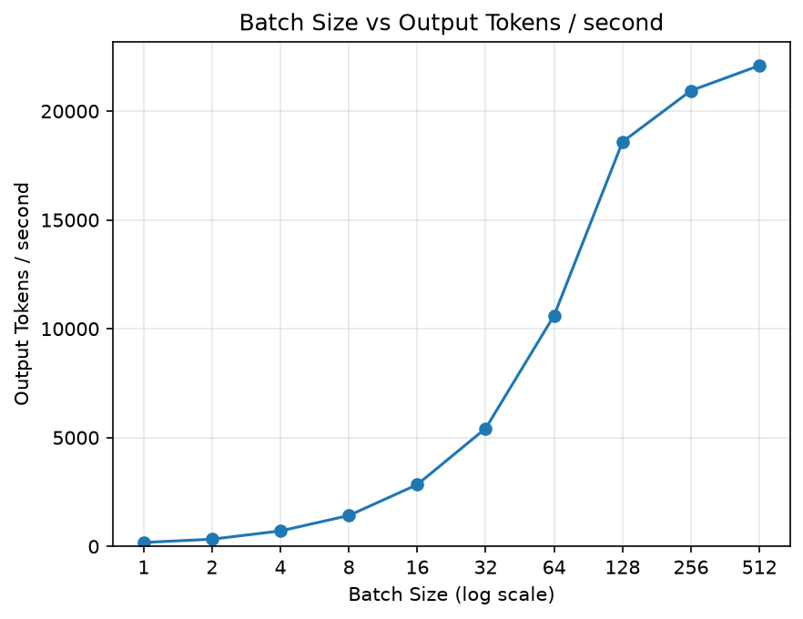

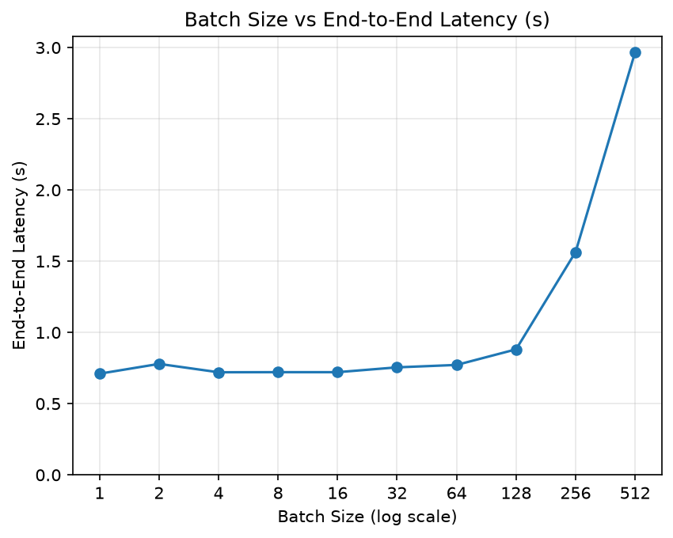

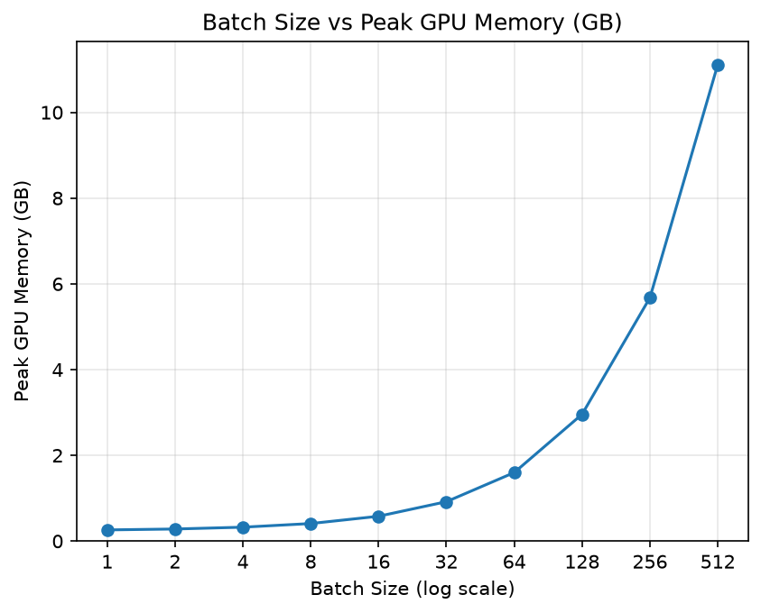

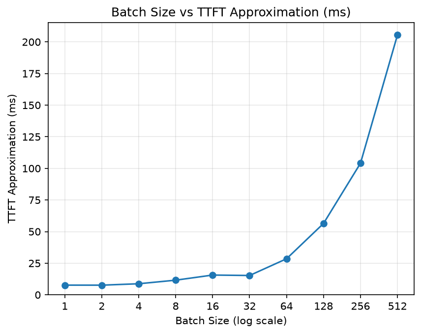

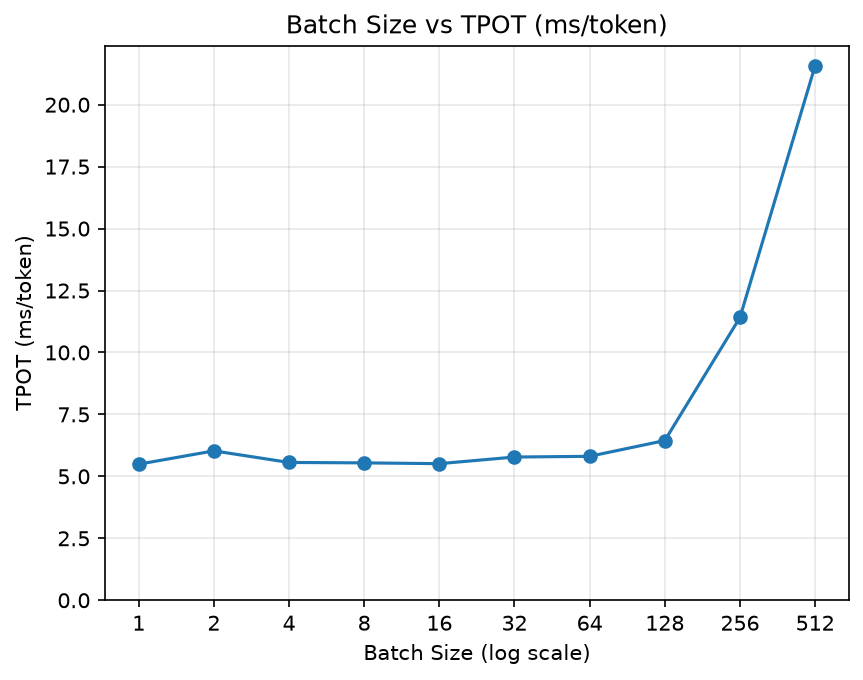

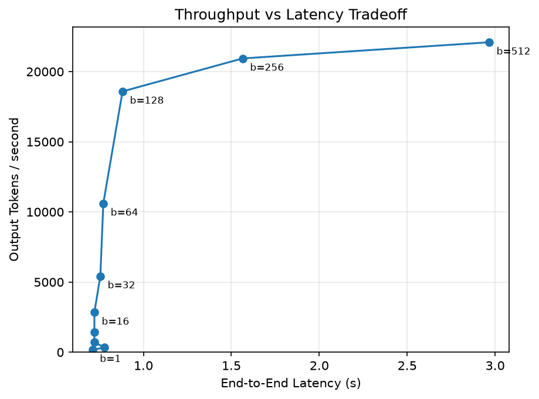

### Analysis

**1. Why can larger batches improve GPU utilization?**

A decode step has two kinds of cost:
- a **fixed** cost paid once per step whatever the batch: reading all the weights from HBM, launching hundreds of kernels, and Python/Hugging Face dispatch;
- a **per-sequence** cost: the arithmetic for that sequence's token and reading its own KV cache.

At batch 1, the fixed cost is almost everything (Parts 1–2): each weight is loaded to do one multiply-add, and the Tensor Cores sit idle. Batching processes *B* sequences in the same step. Every weight read and every kernel launch is shared by *B* tokens, and each layer becomes a *B*-row matrix multiply instead of a matrix-vector product, so arithmetic intensity rises roughly in proportion to *B*.

Our data shows this clearly. From batch 1 to batch 64, TPOT rose only from 5.49 to 5.81 ms, while each step produced 64× more tokens. Throughput went from **180 to 10,612 tokens/s, 59× for a 64× batch** (92% of perfectly linear scaling).

**2. Why does throughput not increase linearly forever?**

Linear scaling lasts only while the fixed cost dominates. The per-sequence cost grows with *B*. A sequence's K/V cannot be shared with other sequences, so the KV bytes read per step grow as *B* × context length. At batch 512, the cache is 2.25–4.5 GiB during decode, and it is read every step (and partly re-copied as Hugging Face's cache grows by concatenation). Matmul FLOPs also grow with *B*.

Once that per-sequence work exceeds the fixed cost, step time grows with *B*. TPOT doubles each time the batch doubles beyond 128 (6.44 → 11.41 → 21.57 ms), so tokens per second stops growing. Decode converges to a constant cost of about **42 µs per token**, and throughput saturates at about **22k tokens/s**, whether the limit is memory bandwidth or compute.

Prefill saturates even earlier. TTFT is flat at batches 1–2, then doubles with each doubling from 64 onward, because a 65,536-token prefill pass is fully compute-bound. Beyond these limits, memory capacity would eventually cap the batch outright: 21.7 MiB per sequence here, far more for a larger model or longer contexts (Part 2).

**3. Where do you observe diminishing returns?**

Between **batch 128 and batch 256**:
- every doubling up to 64 gave 1.9–2.1× more throughput, and 64 → 128 still gave 1.75×;
- **128 → 256 gave only 1.13×, and 256 → 512 only 1.05×**;
- relative to perfectly linear scaling, efficiency falls from 0.92 at 64 to 0.81 at 128, then 0.45 at 256 and 0.24 at 512.

The same knee shows in latency. TPOT first rises noticeably at 128 (6.44 ms), and end-to-end latency jumps from 0.88 s at 128 to 1.57 s at 256 and 2.97 s at 512. In the throughput-vs-latency plot, the curve turns from nearly vertical to nearly horizontal at batch 128.

**4. Why can latency increase even when throughput improves?**

Throughput is a **system-wide** rate: total tokens across all users ÷ time. Latency is what **each individual request** experiences. Batching raises the first by making each request share the GPU with more others, which can slow every one of them down:

- **TTFT** — all *B* prompts are prefilled in one pass before anyone gets a first token. Once prefill is compute-bound, that pass takes time proportional to *B*: 7.7 ms at batch 1, 205 ms at 512.
- **TPOT** — every decode step serves all *B* requests. Once the GPU is saturated, each step takes longer: 5.5 ms → 21.6 ms per token for every user.
- **Batch-level waiting** — in a static batch, every request is tied to the others: it starts when the batch starts and finishes when the batch finishes. In a live system, requests must also wait in a queue for a batch to be formed.

Between batch 128 and 512, throughput improved by only 19% (18,590 → 22,092 tokens/s), but every request's end-to-end latency grew **3.4×** (0.88 → 2.97 s). The system serves more tokens per second by making each user wait longer, which is consistent with Little's law (concurrency = throughput × latency).

**5. For an interactive chatbot, would you choose the max-throughput batch size? Why or why not?**

**No.** A chatbot user experiences TTFT (how long before text starts appearing) and TPOT (how fast it streams), not the aggregate tokens per second. The right choice is the **largest batch that still meets the latency targets, with headroom**, not the maximum-throughput point.

In our measurements, batch 512 maximizes throughput, but the last two doublings buy only 19% more throughput for 3.6× worse TTFT, 3.4× worse TPOT and 3.4× worse end-to-end latency. **Batch 128** gets 84% of the maximum throughput while keeping TPOT at 6.4 ms and TTFT at 56 ms. **Batch 64** is the conservative choice: about half the peak throughput, but essentially no latency cost compared with batch 1.

Running at the knee rather than at saturation also leaves headroom for real traffic. Arrivals are bursty, prompts are longer and varied (a long prompt in a large batch stalls everyone's decode), and queueing delay adds to TTFT. A server that is already saturated has no slack to absorb these, so tail latency grows quickly.

For gpt2 even batch 512 streams faster than people read (about 46 tokens/s per user). For a production-size model, however, every one of these latencies would be one to two orders of magnitude larger, and the same knee would decide whether SLOs are met.

---

## Part 4. Heterogeneous Requests and Serving Engines

### What is asked

- **Task 4.1** — Run static batching on a heterogeneous workload; report throughput, mean latency, P95 latency, and prompt-padding efficiency. Explain padding waste using the prompt lengths 128, 150, 180, 1024.
- **Task 4.2** — Explain what happens with output lengths 20, 25, 200, 30 in naive static batching, and what hardware utilization is lost.
- **Task 4.3** — Compare vLLM against static batching (at minimum requests/s and output tokens/s).
- **Task 4.4** — Explain at least two serving mechanisms: the problem each solves, how it works, and the link to your measurements.

### Workload

| Parameter | Value |
|---|---|
| Requests | 50 (`python workload.py --n 50`, file `workload.json`) |
| Seed | 42 (deterministic, so the same 50 requests are used by every script) |
| Prompt lengths | {32, 64, 128, 256, 512} drawn uniformly. Actual counts: 11 × 32, 9 × 64, 9 × 128, 7 × 256, 14 × 512 |
| Output lengths | {16, 32, 64, 128, 256} drawn uniformly. Actual counts: 11 × 16, 10 × 32, 14 × 64, 5 × 128, 10 × 256 |
| Total useful tokens | **11,040** prompt tokens, **4,592** output tokens |
| Arrival process | Poisson at 5 requests/s (the last arrival is at 12.0 s). Arrival times are **not** used: both offline scripts treat all 50 requests as available at t = 0 |

Prompt lengths are capped at 512 (the starter workload also included 1024) so that every static batch (padded prompt + longest output ≤ 512 + 256) and every vLLM request fits gpt2's 1024-token context.

Both systems ran on the same A100 in FP16. Each configuration was run 3 times after a warm-up, and the tables report the mean. All standard deviations were below 0.7%; they are in `results/part4_*_std.csv`.

### Task 4.1 — Static batching results

`part4_static_batching.py` processes the workload in arrival order, in fixed groups of *B* requests. Each group is left-padded to its longest prompt and generated with `model.generate()` until its longest output is finished. We added `min_new_tokens = max_output` so a batch cannot stop early on EOS.

Two latency definitions are reported:
- **Batch latency** is the starter's definition: the `generate()` time of the batch a request belongs to.
- **Completion time** is the time from the start of the run until the request's batch finishes. Batches run one after another and every request is ready at t = 0, so this includes the time a request waits behind earlier batches.

| Static batch size | 1 | 4 | 8 | 16 |
|---|---:|---:|---:|---:|
| Time for all 50 requests (s) | 28.50 | 17.51 | 11.41 | 5.97 |
| **Throughput (requests/s)** | 1.75 | 2.86 | 4.38 | 8.37 |
| **Output tokens/s** (useful) | 161 | 262 | 403 | 769 |
| Generated tokens/s (incl. wasted) | 161 | 563 | 1,089 | 2,078 |
| **Mean batch latency (s)** | 0.57 | 1.38 | 1.77 | 1.78 |
| **P95 batch latency (s)** | 1.59 | 1.80 | 1.83 | 1.84 |
| Mean completion time (s) | 12.77 | 8.60 | 6.59 | 3.77 |
| P95 completion time (s) | 26.99 | 17.06 | 10.95 | 5.52 |
| **Prompt-padding efficiency** | 1.000 | 0.513 | 0.431 | 0.431 |
| Output (decode) efficiency | 1.000 | 0.466 | 0.370 | 0.370 |

**Padding efficiency** is useful prompt tokens ÷ (batch size × longest prompt in the batch). **Output efficiency** is requested output tokens ÷ (batch size × longest output in the batch).

Larger static batches raise throughput, since batching amortizes per-step overhead (Part 3), but efficiency falls.
- At *B* ≥ 8 almost every batch contains both a 512-token prompt (14 of the 50 requests have one) and a 256-token output (10 of 50). Nearly every batch is therefore padded to 512 × 256. Only **43% of prompt positions and 37% of decode slots do useful work**, and batches 8 and 16 have identical efficiencies.
- At batch 16 the GPU generates 2,078 tokens/s, but only 769 tokens/s belong to a request's actual output.
- Batch latency grows with *B* (0.57 → 1.78 s) because every batch now runs for 256 decode steps, about 7.0 ms each at batch 16.

**Why heterogeneous prompt lengths cause padding waste.** A batch is one rectangular tensor of shape [*B*, max prompt length]. Shorter prompts are filled with pad tokens; the attention mask stops other tokens from attending to them, but they still flow through every GEMM, every layer and the KV cache.

For prompts of **128, 150, 180 and 1024** tokens:

| | Tokens |
|---|---:|
| Useful prompt tokens | 128 + 150 + 180 + 1024 = **1,482** |
| Processed after padding | 4 × 1024 = **4,096** |
| Padding efficiency | 1,482 / 4,096 = **36.2%** |
| Wasted pad positions | 2,614 (**63.8%**) |

The linear layers do 2.76× more work than necessary. Attention is worse, because its cost grows with the square of sequence length: useful query-key pairs are (128² + 150² + 180² + 1024²) / (4 × 1024²) = **26.7%** of those computed. The KV cache is also sized for 4 × 1024 positions.

A single long prompt sets the cost for the whole batch. Our measured 43–51% efficiency shows the same effect on the real workload. (A 1024-token prompt would exceed gpt2's context once outputs are added, so this example is analytical.)

### Task 4.2 — Output-length heterogeneity (20, 25, 200, 30)

In naive static batching the batch is the unit of work: it leaves the GPU only when **every** member has finished. A batch with output lengths 20, 25, 200 and 30 therefore runs **200 decode steps**, and every step still computes all 4 rows. Hugging Face `generate()` keeps producing pad tokens for finished rows.

| Decode steps | Rows doing useful work | Utilization of the 4 slots |
|---|---:|---:|
| 1–20 | 4 | 100% |
| 21–25 | 3 | 75% |
| 26–30 | 2 | 50% |
| 31–200 | **1** | **25%** |

Useful work is 20 + 25 + 200 + 30 = 275 token-steps out of 4 × 200 = 800 computed. That is **34.4% efficiency, so 65.6% of decode work is wasted**, and for 85% of the batch's lifetime (steps 31–200) three of the four slots compute nothing useful.

The hardware utilization lost (also TODO 3 in `part4_static_batching.py`):
- **Compute and memory bandwidth** spent on rows that are already done: their weights are read and multiplied for every step, and they consume slots that could serve other requests.
- **KV-cache memory** held by finished requests until the batch ends, which reduces how many requests can fit (Part 2).
- **Latency for short requests.** The 20-token request cannot be returned until step 200, so it waits 10× longer than it needs to.
- **Head-of-line blocking.** Waiting requests cannot start until the whole batch finishes, which adds to queueing delay and TTFT.

We measured this directly. Output efficiency was **0.466 at batch 4 and 0.370 at batches 8 and 16**, meaning 53–63% of all decode work was spent on tokens nobody asked for.

**If requests could leave the batch immediately after completing:**
- each finished request's result would be returned at once, and its slot and KV memory freed;
- a waiting request could take the freed slot at the next step, so the batch would stay full of useful work instead of decaying to one active row;
- short requests would see latency proportional to their own length, not the longest request's;
- decode throughput would rise by up to 1 / output efficiency, about 2.7× at batch 16 even without any other optimization.

This iteration-level scheduling is **continuous batching**, which vLLM implements (Task 4.4).

### Task 4.3 — vLLM comparison

**vLLM configuration.**

| Setting | Value |
|---|---|
| Engine | vLLM 0.32.0 (V1 engine), offline `LLM.generate()` with all 50 requests submitted at once |
| Model / precision | gpt2, `dtype=float16`. vLLM's `auto` would otherwise downcast gpt2's FP32 checkpoint to **bfloat16**, so FP16 was set explicitly to match the Hugging Face runs |
| Prompts | Exactly `prompt_length` random token IDs per request (`--exact-workload`) |
| Outputs | One `SamplingParams` per request: `temperature=0`, `max_tokens=output_length`, `ignore_eos=True` |
| Engine defaults (from log) | FlashAttention-2 backend; torch.compile + CUDA graphs captured for batch sizes 1–512; chunked prefill (`max_num_batched_tokens=8192`); prefix caching on; KV cache 72.24 GiB = 2,104,240 tokens |
| Repetitions | 3, after a 4-request warm-up. Each repetition uses **fresh random prompts**, so the prefix cache cannot reuse the previous repetition's prompts |
| Environment fix | vLLM's FlashInfer sampling kernel is compiled at startup and needs `nvcc`. We loaded Sol's CUDA module and installed `ninja`. This affects only token sampling, which is identical under greedy decoding |

vLLM reported **4,592 output tokens and 11,040 prompt tokens** in every repetition, exactly the workload's totals, so it did the same work as static batching.

| System | Time for 50 requests (s) | **Requests/s** | **Output tokens/s** | vLLM speedup (tokens/s) |
|---|---:|---:|---:|---:|
| Static, *B* = 1 | 28.50 | 1.75 | 161 | 72× |
| Static, *B* = 4 | 17.51 | 2.86 | 262 | 44× |
| Static, *B* = 8 | 11.41 | 4.38 | 403 | 29× |
| Static, *B* = 16 | 5.97 | 8.37 | 769 | 15.1× |
| **vLLM** | **0.394 ± 0.001** | **126.8 ± 0.3** | **11,642 ± 26** | — |

**Latency.** The offline API gives no per-request timestamps, so we cannot report vLLM's TTFT, TPOT or P95 here. However, all 50 requests finished within **0.394 s** of submission, which bounds every request's completion time. The best static configuration (*B* = 16) had a mean completion time of 3.77 s and a P95 of 5.52 s, so even vLLM's slowest request finished **14× sooner** than the static P95. Measuring TTFT/TPOT under real Poisson arrivals would require the online server and an async client, which we did not run.

**Where the 15× gap over the best static configuration comes from.**
1. **No wasted work.**
   - Static *B* = 16 processed 25,600 prompt positions and 12,416 decode slots to deliver 11,040 useful prompt tokens and 4,592 useful output tokens.
   - vLLM processes only the useful tokens. Prompts are packed into one flat token batch without padding, and finished requests leave immediately.
2. **Larger effective batch.** All 50 requests run concurrently, versus 16. Part 3 showed throughput rising almost linearly with batch size in this range.
3. **Much lower per-step overhead.**
   - The longest request needs 256 decode iterations, so vLLM's 0.394 s implies **≤ 1.54 ms per iteration** with up to 50 sequences.
   - Hugging Face needed about 5.5 ms per step at batch 1 (Part 1) and about 7.0 ms per step for static *B* = 16 here.
   - CUDA graphs and compiled, fused kernels remove most of the Python and launch overhead that dominated Parts 1–3.

**Why a single `max_tokens` does not reproduce heterogeneous output lengths (TODO 4 in `part4_vllm_offline.py`).** The starter script gave every request `SamplingParams(max_tokens=64)` and prompts of `"hello " * n`.
- **Every request generates exactly 64 tokens** (3,200 in total) instead of the workload's 16–256 (4,592 in total). The amount of decode work is wrong, short requests run longer than they should, and long ones are cut off.
- **Output-length heterogeneity disappears.** That heterogeneity is exactly what makes static batching waste work and what continuous batching exploits, so removing it changes what is being compared. The longest request needs 64 decode iterations instead of 256.
- **Without `ignore_eos`, a request may stop early** if it generates EOS, so even `max_tokens` is only an upper bound.
- **Prompt lengths are only approximate.** `"hello " * n` tokenizes to *n* + 1 tokens: 11,090 instead of 11,040.
- **Every prompt shares the same prefix** (`hello hello …`). With prefix caching on, vLLM can reuse cached KV blocks across requests and skip much of the prefill, which the real workload would not allow.

We ran the starter configuration as well (`--no-exact-workload`):

| vLLM configuration | Output tokens | Prompt tokens | Time (s) | Requests/s | Output tokens/s |
|---|---:|---:|---:|---:|---:|
| Starter: single `max_tokens=64`, `"hello "` prompts | 3,200 | 11,090 | 0.162 | 308.6 | 19,749 |
| Exact workload (used above) | 4,592 | 11,040 | 0.394 | 126.8 | 11,642 |

The starter setting reports **2.4× more requests/s** for a different, easier workload. Comparing it with static batching (which honours each request's output length) would overstate vLLM's advantage, so the comparison above uses per-request `max_tokens` with `ignore_eos=True` and exact-length token prompts.

### Part 4 plots

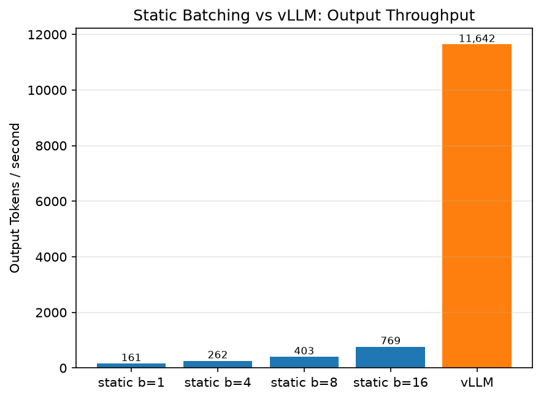

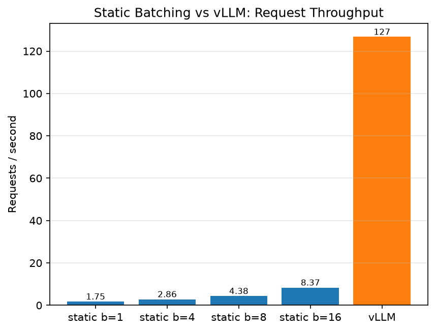

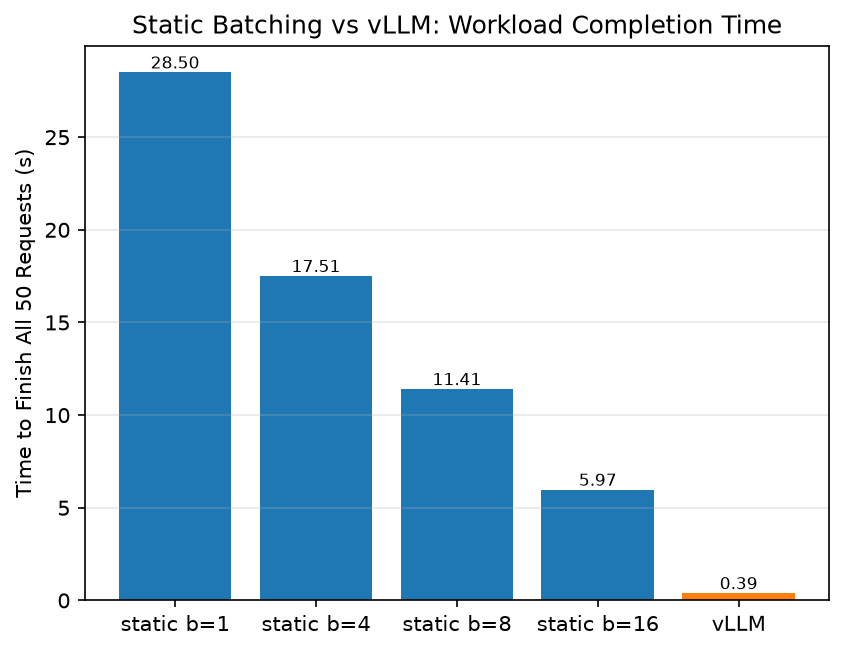

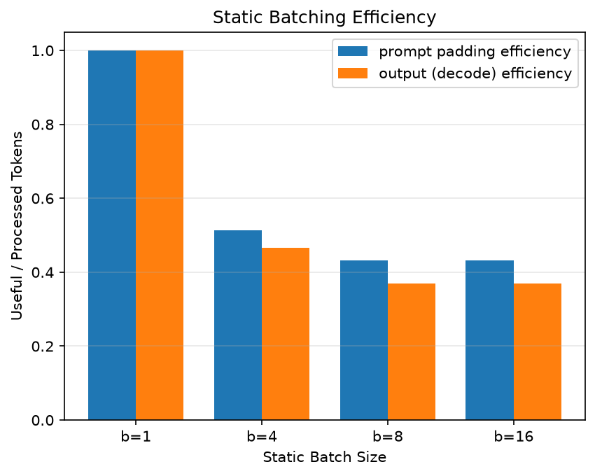

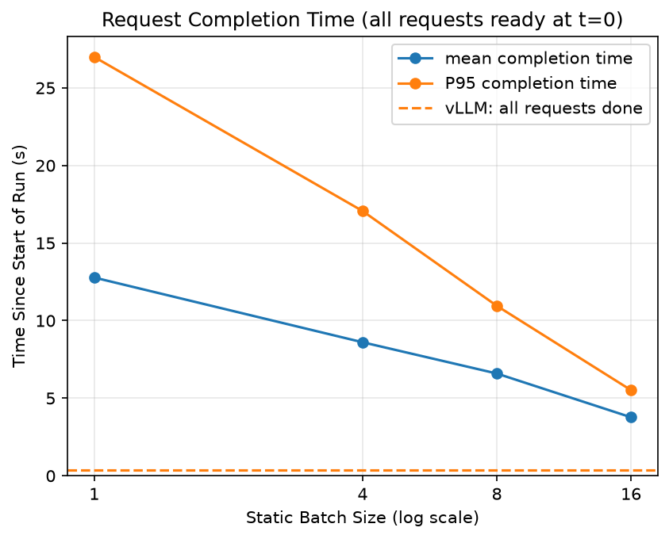

### Task 4.4 — Systems mechanisms

#### Mechanism 1: Continuous batching (iteration-level scheduling)
- **Problem addressed:** Static batching fixes batch membership until the longest request finishes. Shorter prompts are padded, finished rows keep consuming slots, short requests wait for long ones, and new requests wait for the whole batch (Tasks 4.1 and 4.2).
- **How it works:**
  - The scheduler makes a decision **every iteration** (one model step) rather than every batch.
  - After each step, finished sequences are removed and returned immediately. Waiting requests are admitted as soon as KV memory and the per-step token budget allow.
  - The tokens of all running sequences are concatenated into one flat batch with no padding, and per-sequence lengths are passed to a variable-length attention kernel.
  - vLLM also mixes new requests' prefill with ongoing decodes in the same iteration (chunked prefill, `max_num_batched_tokens=8192` in our log), so a long prompt does not stall everyone else's decoding.
- **Connection to measurements:**
  - Static *B* = 16 achieved only 43% prompt and 37% decode efficiency. vLLM's reported token counts equal the workload's useful tokens exactly, so it wasted nothing.
  - Even with every request ready at t = 0, static batching's P95 completion time was 5.52 s, against 0.394 s for vLLM to finish all 50.
  - Continuous batching alone would recover the up to 2.7× decode waste measured in Task 4.2.

#### Mechanism 2: Paged KV-cache management (PagedAttention)
- **Problem addressed:**
  - With contiguous per-request KV buffers, a server must reserve space for each request's *maximum* possible length, because output length is unknown in advance. Most of that space is never used, and buffers of different sizes fragment GPU memory.
  - Part 2 showed that the KV budget is what limits concurrency. We also saw PyTorch's allocator reserve all 80 GB for only a few GB of live, growing tensors.
- **How it works:**
  - At startup vLLM allocates the KV cache once, as a pool of fixed-size **blocks** (a few tokens each).
  - Each sequence has a **block table** mapping its logical token positions to physical blocks, like virtual-memory pages. Blocks are allocated only as the sequence grows and are returned to the pool when it finishes.
  - The attention kernel reads K/V through the block table, so a sequence's blocks need not be contiguous. Waste is limited to the last, partly filled block of each sequence.
  - Blocks can be shared between sequences with a common prefix, which is the basis of **prefix caching**.
- **Connection to measurements:**
  - vLLM's startup log reported **72.24 GiB available for KV cache = 2,104,240 tokens**, i.e. 72.24 GiB ÷ 2,104,240 = **36.0 KiB per token**. That is exactly the gpt2 value from our Part 2 formula (2 × 12 × 12 × 64 × 2 B).
  - It also reported a maximum concurrency of **2,055 requests of 1,024 tokens**. Our entire workload (≤ 15,632 tokens) used under 1% of the pool, so all 50 requests could run concurrently.
  - The prefix-caching effect is visible in the starter configuration, whose shared `"hello …"` prompts let requests reuse cached blocks.

#### Mechanism 3: Optimized kernels and CUDA graphs
- **Problem addressed:** In Parts 1–3, Hugging Face's eager execution spent about 5.5 ms per decode step on Python dispatch and hundreds of small kernel launches, while the GPU's actual work was far smaller.
- **How it works:**
  - vLLM compiles the model with `torch.compile`, which fuses elementwise operations into fewer kernels.
  - It **captures CUDA graphs** of the whole decode step for batch sizes 1–512 (`Capturing CUDA graphs … 51/51` in the log). Each later step then replays the recorded graph with a single launch, with no per-kernel CPU overhead.
  - Attention uses FlashAttention-2's variable-length kernels, which handle ragged batches without padding and read K/V directly from paged blocks.
- **Connection to measurements:**
  - The 256-iteration workload finished in 0.394 s, **≤ 1.54 ms per iteration** for up to 50 sequences.
  - Hugging Face took about 5.5 ms per step at batch 1 (Part 1) and about 7.0 ms at static batch 16, so vLLM's per-step cost is at least 3.6–4.5× lower.
  - For a model as small as gpt2, this overhead reduction is a large part of vLLM's 15× advantage. For larger models, where GPU work dominates, continuous batching and paged memory would account for more of the gain.

---

## Part 5. Serving Design Challenge

### What is asked

Design a policy for a single-GPU service with continuous arrivals and heterogeneous requests that meets the TTFT and TPOT SLOs while maximizing throughput. Cover each topic below and discuss tradeoffs.

### Goals and the facts the design is built on

The service must keep

$$
\text{P95(TTFT)} < T_{TTFT} = 1\ \text{s} \qquad \text{and} \qquad \text{P95(TPOT)} < T_{TPOT} = 50\ \text{ms/token}
$$

while maximizing throughput. We treat **goodput** (requests per second that meet *both* SLOs) as the quantity to maximize, because raw throughput can always be raised by letting latency grow. The controllers below aim at **80% of each target** (0.8 s TTFT, 40 ms TPOT), so that bursts and measurement noise do not push the 95th percentile over the limit.

The policy is built on what Parts 1–4 measured on our A100:

| Measured fact | Source | Design consequence |
|---|---|---|
| A decode step costs about the same for 1 or 64 sequences (TPOT 5.5 → 5.8 ms); TPOT then rises to 6.4, 11.4 and 21.6 ms at 128, 256 and 512 | Part 3 | Decode batch size is the main TPOT control knob, and there is a measurable knee to operate at |
| Prefill cost grows with the tokens in the batch; 65,536 prompt tokens took 205 ms | Parts 1, 3 | A large prefill inserted into a decode step stalls every running stream, so prefill must be bounded per step |
| KV cache = 36 KiB/token for gpt2 (128 KiB/token for an 8B-class model) and grows with every generated token | Part 2 | Memory, not compute, caps concurrency; it must be allocated incrementally |
| Static batching wasted 57–63% of prompt and decode work on padding and finished requests | Part 4 | Batch membership must change every iteration (continuous batching) |
| vLLM ran ≤ 1.54 ms per iteration vs about 5.5–7 ms for eager Hugging Face | Parts 1, 4 | Use a serving engine with CUDA graphs and fused kernels; the scheduler's budgets assume this per-step cost |

The design below therefore assumes a vLLM-style engine (paged KV cache, continuous batching, chunked prefill, CUDA graphs) and specifies the **policy** that runs on top of it.

### Checking the SLOs against our measurements

**TPOT < 50 ms.**
- In Part 3, every batch size we ran met the TPOT target, even with eager Hugging Face: TPOT was 5.5 ms at batch 1 and 21.6 ms at batch 512 (prompt 128, output 128).
- Beyond saturation, decode cost about 42 µs per sequence per step, so a 40 ms step budget corresponds to roughly 950 concurrent gpt2 sequences at these context lengths. This is a rough extrapolation, and longer contexts lower it.
- **For gpt2 on an A100, TPOT is therefore not the binding constraint at realistic loads.** The same SLO becomes binding for larger models. An 8B-class model must read about 16 GB of weights every step, which is at least about 8 ms at 2 TB/s before any KV reads, so the decode batch would have to stop growing much earlier. This is why B_max is driven by measured TPOT (Section 2) rather than fixed.

**TTFT < 1 s.**
- Prefill alone is far below the target: 7.7 ms for one 128-token prompt and 205 ms for 512 prompts at once (Part 3).
- With continuous arrivals, though, **TTFT is dominated by queueing**: time waiting to be admitted, and time waiting for earlier prefills.
- Part 4 shows what scheduling does to this. With all 50 requests ready at t = 0:
  - **Static batching misses the target badly.** At batch 16, a request in batch *k* waits for *k* − 1 earlier batches of about 1.78 s each before its own prefill starts. The 34 requests in batches 2–4 (68%) therefore see TTFTs of about 1.8, 3.6 and 5.3 s, and P95 TTFT is about 5.3 s.
  - **vLLM completed every request within 0.394 s**, which bounds every TTFT below 1 s.
- At the measured prefill rate (about 320k tokens/s for gpt2 at saturation), the 0.8 s TTFT budget covers roughly 250k prompt tokens of queued prefill. That figure is what admission control (Section 6) protects.

**Operating point for this service:** on the gpt2/A100 setup, both SLOs are comfortably met at the Part 3 knee (batch about 128: TPOT 6.4 ms, prefill-only TTFT 56 ms). Throughput can therefore be pushed further, toward batch 256–512 (TPOT 11–22 ms), while staying under 50 ms. **The SLOs leave room to trade latency for throughput here, and the controllers in Sections 2–3 do exactly that** until measured P95 approaches 80% of either target.

### 1. Request scheduling

- **Two queues:**
  - a *waiting* queue of requests that have not started prefill;
  - a *running* set of requests that are prefilling or decoding.
- **Order of the waiting queue: earliest TTFT deadline first** (deadline = arrival time + T_TTFT). With a single priority class this reduces to first-come-first-served, which is fair and starvation-free. Separate priority classes (e.g., interactive chat vs. batch jobs) are supported by giving each class its own deadline: batch jobs get a long or no TTFT deadline and fill leftover capacity.
- **Running requests always take precedence over waiting ones** when the per-iteration budget is divided (Section 3). A user who is already streaming notices a stall immediately; a user whose first token is a few milliseconds later does not.
- **Why not shortest-job-first?** Output length is unknown at arrival, and SJF can starve long requests. As a mild form of it, prompts that can be prefilled in a single chunk may be admitted ahead of long prompts with the same deadline, with **aging** so that a long prompt cannot be passed over indefinitely.

### 2. Continuous / dynamic batching

- **Iteration-level batching.** Every model step, finished requests leave immediately (their results are returned and KV blocks freed) and waiting requests are admitted into the freed capacity. This removes the padding and finished-row waste measured in Part 4 (43% prompt and 37% decode efficiency for static batching).
- **The decode batch size is chosen by TPOT, not by throughput.** The scheduler keeps a **cap B_max** on the number of running sequences, and the steady-state decode step time must stay below T_TPOT with headroom (we use 80% of T_TPOT so bursts don't push P95 over).
  - From Part 3, a cap near **128** gives 84% of the maximum throughput at only +17% TPOT over batch 1. Going from 128 to 512 adds only 19% more throughput but makes TPOT 3.4× worse (6.4 → 21.6 ms). The knee is the **starting point**. Because even 21.6 ms is well under the 40 ms working target, the controller below is allowed to grow B_max past it for extra throughput. With a larger model it would stop much earlier.
  - B_max is **adapted online**: every few seconds the scheduler compares measured P95 TPOT to the target. If P95 exceeds the 80% target it lowers B_max multiplicatively; if there is slack it raises B_max additively (AIMD). This tracks changes in context length, since longer contexts make each step more expensive (Part 2).
- **One flat token batch.** Sequences are packed without padding and attention runs on variable-length kernels, so mixing a 32-token and a 512-token request costs only their real tokens.

### 3. Prefill vs. decode scheduling

- **The problem.** Prefill and decode compete for the same GPU steps.
  - Prioritizing prefill improves TTFT for new arrivals, but a large prefill in a step delays every running stream's next token, hurting TPOT. Part 3 measured 205 ms for one 65k-token prefill; inserted into decoding, that is a 200 ms pause for every active user.
  - Prioritizing decode protects TPOT but lets TTFT grow without bound under load.
- **Policy: chunked prefill with a per-iteration token budget *K*.**
  - Each iteration first includes **one token for every running decode** (protecting TPOT), then fills the rest of the budget with **prefill chunks** from waiting requests in deadline order.
  - A long prompt is split across several iterations.
  - *K* is chosen so that one iteration (all decodes plus *K* − (#decodes) prefill tokens) still fits within the TPOT target.
  - *K* is the direct knob between the two SLOs: larger *K* gives faster TTFT and higher prefill throughput; smaller *K* gives smoother TPOT. We start at *K* ≈ 2048 tokens (vLLM's default chunk size was 8192 on our A100), and the same AIMD controller nudges *K* down when TPOT is at risk and up when TTFT is at risk.
- **Alternative.** With several GPUs, prefill and decode can run on separate instances (disaggregated serving) so they never interfere. On the single GPU in this challenge, chunked prefill is the practical form of that separation.

### 4. KV-cache allocation

- **Paged allocation.** At startup the engine reserves the KV pool from all memory not used by weights and activations, and divides it into fixed-size blocks (e.g., 16 tokens).
  - Each sequence has a block table, and blocks are allocated **on demand** as the sequence grows. Fragmentation is limited to one partly filled block per sequence, and there is no up-front reservation for an unknown output length.
  - On our A100 this pool was 72.24 GiB = 2.1M tokens of gpt2 KV (Part 4). For an 8B-class model it would be roughly 60 GB / 128 KiB ≈ 460k tokens, about 110 concurrent 4k-token requests (Part 2).
- **Admission reserves the prompt plus a watermark.** A request is admitted only if its prompt blocks fit *and* at least a watermark (e.g., 5% of the pool) remains free. The watermark lets running sequences keep growing without immediate eviction.
- **Preemption when the pool runs out.** If decoding needs a new block and none are free, the scheduler **preempts the most recently admitted, lowest-priority request**: it frees its blocks and moves it back to the head of the waiting queue.
  - It is resumed by **recomputing** its prefill rather than swapping KV to CPU memory. For short and medium prompts, recompute is cheap: Part 1 prefilled 768 tokens in about 8 ms with Hugging Face, faster with a tuned engine.
  - Swapping is reserved for very long contexts, where recompute is expensive.
- **Prefix caching.** Blocks with a shared prefix (system prompts, multi-turn chat history) are reference-counted and reused. This saves both memory and prefill time. Our starter vLLM run showed the effect: identical `"hello …"` prompts made the workload 2.4× faster in requests/s.

### 5. Handling long-context requests

Long prompts are costly in three ways, and each needs its own control:

1. **Prefill time.** TTFT can never be smaller than the prefill time, which grows with prompt length (linearly for the linear layers, quadratically for attention). **Chunked prefill** (Section 3) keeps a long prompt from stalling running decodes. **Admission** (Section 6) estimates the request's TTFT from its length; if even an empty queue could not meet T_TTFT, the request is placed in a long-context class with a relaxed, documented TTFT target rather than silently missing the SLO.
2. **KV memory.** A 32k-token request on an 8B-class model holds about 4 GiB of KV, as much as eight 4k-token requests (Part 2). To keep long requests from crowding out short interactive ones, long-context requests may use **at most a fixed share of the KV pool** (e.g., 30%), and at most a fixed number of them may be prefilling at once.
3. **Per-step cost.** Every decode step of a long-context request reads its whole KV cache, which raises the step time for everyone in the batch. The AIMD controller in Section 2 lowers B_max automatically when the average context grows. Long requests are also the first candidates for swap-based preemption (Section 4), since recomputing them is expensive.

Prefix caching is especially valuable for long contexts that are reused (documents, long chat histories). A hard maximum context length (1024 tokens for gpt2) is enforced at admission.

### 6. Admission control

When a request arrives, the scheduler admits it to the waiting queue only if all three checks pass:

1. **Memory.** Its prompt blocks plus the watermark fit in the free KV pool, either now or after requests expected to finish within its TTFT deadline release their blocks.
2. **Predicted TTFT ≤ T_TTFT.** The prediction is (prefill tokens queued ahead of it + its own prompt length) ÷ measured prefill throughput under the current *K*, plus one iteration. The prefill rate is calibrated online. Part 3's batch-512 prefill gives a scale reference: about 320k tokens/s at saturation for gpt2.
3. **Capacity.** The running batch stays below B_max, so admitting it does not push existing streams past T_TPOT.

If a check fails, the request waits in a **bounded** queue. If it is still waiting when its predicted TTFT exceeds the deadline, it is **rejected early** (HTTP 429 with a `Retry-After` hint), not served late.

Rejecting a few requests quickly protects the SLOs of all the others and gives clients a clear signal to retry or route elsewhere. Admitting everything makes every request miss its SLO under overload.

A capacity estimate guides provisioning. By Little's law, sustainable request rate ≈ decode throughput at the chosen operating point ÷ average output length. For our gpt2 numbers: about 18.6k tokens/s at the batch-128 knee (Part 3) ÷ 92 output tokens per request (Part 4 workload) ≈ 200 requests/s. Arrival rates above that cannot be met with any scheduler.

### 7. Overload behaviour

When arrivals persistently exceed capacity, the policy degrades in this order, protecting requests already being served:

1. **Protect running streams.** Never admit work that would push running requests past T_TPOT. B_max and *K* are lowered first, which trades TTFT for new requests against TPOT for current ones.
2. **Shed by deadline.** Drop requests whose TTFT deadline has already passed, since serving them late wastes capacity. Then reject new arrivals early, with `Retry-After`.
3. **Shed by priority and cost.** Pause batch-class requests, then stop admitting long-context requests, which consume the most prefill time and KV memory per request.
4. **Reduce work per request.** Cap `max_tokens` for new requests during overload, a visible but graceful degradation compared with timeouts.
5. **Avoid thrashing.** Limit the preemption rate and use hysteresis in the controllers, so the system does not repeatedly evict and recompute the same requests. If preemption increases, the admission thresholds are tightened.

The metric watched throughout is **goodput** and **SLO attainment**, not raw tokens/s. Part 3 showed throughput can keep rising while every user's latency gets worse.

### Tradeoffs

| Decision | Gains | Costs | Our choice |
|---|---|---|---|
| Larger decode batch (B_max) | Throughput: 180 → 22k tokens/s from batch 1 to 512 (Part 3) | TPOT and TTFT rise sharply after the knee (TPOT 6.4 → 21.6 ms) | Start at the knee (about 128 for gpt2); grow while measured P95 TPOT < 40 ms (allows about 256–512 for gpt2) |
| Larger prefill chunk *K* | Lower TTFT and higher prefill efficiency | Longer iterations, so TPOT spikes for running streams | Moderate *K*, tuned by whichever SLO is closer to violation |
| Decode-first vs. prefill-first | Decode-first protects TPOT | New requests wait longer (TTFT) | Decode-first, with a guaranteed prefill share via *K* |
| FCFS/deadline vs. shortest-job-first | Fairness; no starvation | Short requests can wait behind long prompts | Deadline order with limited, aged preference for short prompts |
| Strict admission / early rejection | SLOs kept for admitted requests; predictable latency | Some requests refused even though they would eventually be served | Reject when predicted TTFT > target; bounded queue |
| KV watermark and long-context quota | Fewer preemptions; short requests protected | Less concurrency, idle memory | Small watermark (about 5%); cap long-context share of the pool |
| Recompute vs. swap on preemption | Recompute: no CPU memory or PCIe traffic | Redundant prefill compute (Part 2) | Recompute for short prompts, swap for long ones |
| Prefix caching | Big TTFT and memory savings for shared prefixes (2.4× in Part 4) | Cached blocks occupy pool space; eviction policy needed | On, with LRU eviction of unreferenced blocks |

---

## Part 6. Interpretation and Reflection

### What is asked

300–500 words: *Why is LLM serving fundamentally a systems problem rather than simply a model-inference problem?* Use evidence from the experiments.

### Reflection

Every experiment in this assignment ran the same 124M-parameter gpt2 in FP16 on the same A100, with the same weights and the same arithmetic. Yet the measured performance varied by two orders of magnitude, and almost none of that variation came from the model. It came from how computation, memory and requests were organized around it. That is why LLM serving is a systems problem.

First, the GPU is rarely limited by the model's math. In Part 1, a 768-token prefill needed only about 0.8 ms of arithmetic but took 7.6 ms, and each decode step took 5.6 ms when reading the weights should take about 0.12 ms. A single-token decode step is dominated by fixed per-step costs (Python dispatch, kernel launches, weight reads), not by FLOPs. Whether the hardware is used well depends on how work is grouped, not on the network itself.

Second, the right optimization depends on the operating regime. The KV cache is a textbook algorithmic improvement, yet at batch 1 it made no measurable difference (0.99–1.06×) because per-step overhead hid the recomputation. At batch 32 it was 9.2× faster, and its benefit grew with sequence length exactly as predicted. Caching also turns a compute problem into a memory problem: 36 KiB per token for gpt2 means the KV cache, not compute, decides how many requests fit on the GPU.

Third, throughput and latency are policy choices. In Part 3, batching raised throughput 123×, from 180 to 22,092 tokens/s, without changing the model. Beyond batch 128, however, the last 19% of throughput cost 3.4× worse per-user latency. No single "fastest" configuration exists. The operator must choose a point on the tradeoff curve that satisfies an SLO, which is a scheduling decision.

Fourth, and most strikingly, Part 4 ran an identical workload, model, GPU and precision through two serving strategies. Static batching wasted 57–63% of its prompt and decode work on padding and finished requests, and its P95 time to first token was about 5.3 s. vLLM, using continuous batching, paged KV memory and CUDA graphs, served the same 50 requests 15–72× faster and finished all of them within 0.4 s. Its log reported 36.0 KiB per KV token, the same quantity we derived in Part 2. The difference was entirely in scheduling, memory management and kernel execution.

Finally, the operational problems we hit were classic systems issues: allocator fragmentation that reserved 80 GB for a few GB of live data, an engine that silently chose bfloat16, and a missing compiler that prevented startup.

Model inference answers "what does this network compute for one input?" Serving must answer how to share one GPU's compute, memory capacity and bandwidth among many requests whose lengths and arrival times are unknown, under latency targets that conflict with throughput. Those are the questions of scheduling, caching, virtual memory and admission control, which makes LLM serving fundamentally a systems problem.

---

## Reproducibility

[`README.md`](README.md) gives everything needed to reproduce these results: the Sol environment setup (`setup.sh`), the extra CUDA/`ninja` setup vLLM needed, the exact command for every experiment, how each plot was generated, and a list of every change made to the starter code.

All raw per-repetition results and their mean/std aggregates are in `results/`, and every figure (PDF and PNG) is in `plots/`.

## Deliverables

- [ ] Source code
- [ ] This report (exported to PDF)
- [ ] Plots
- [ ] CSV result files
- [ ] README with reproduction steps
